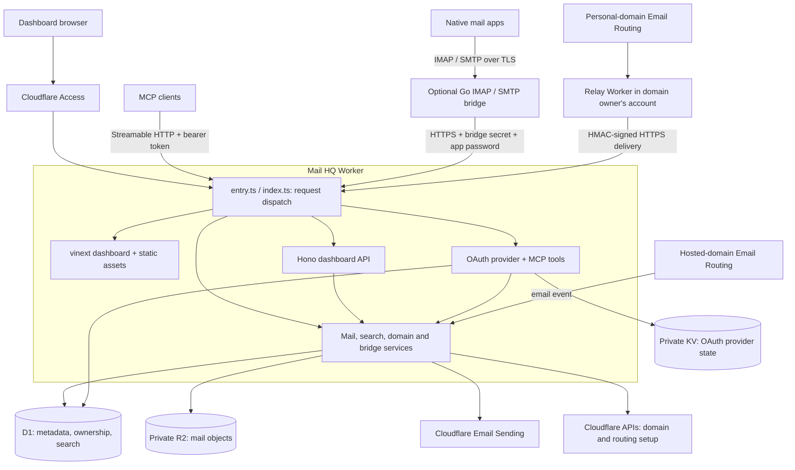
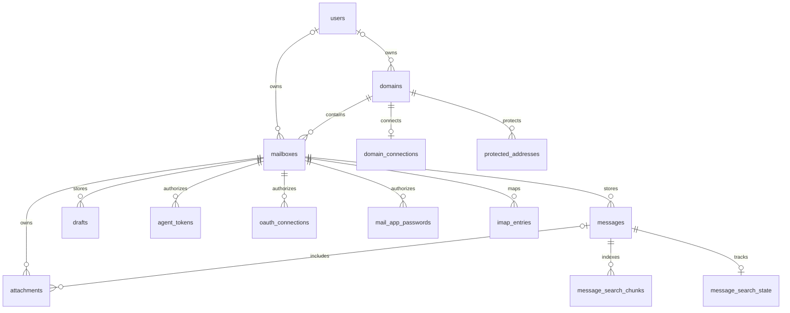
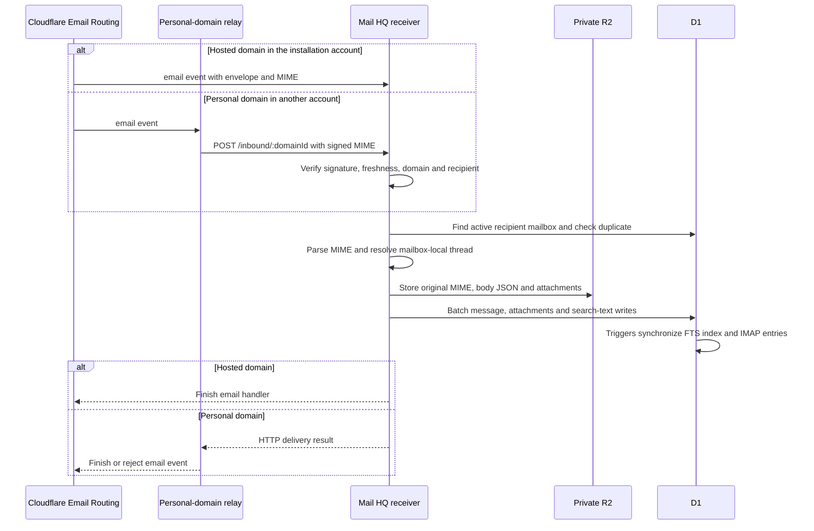
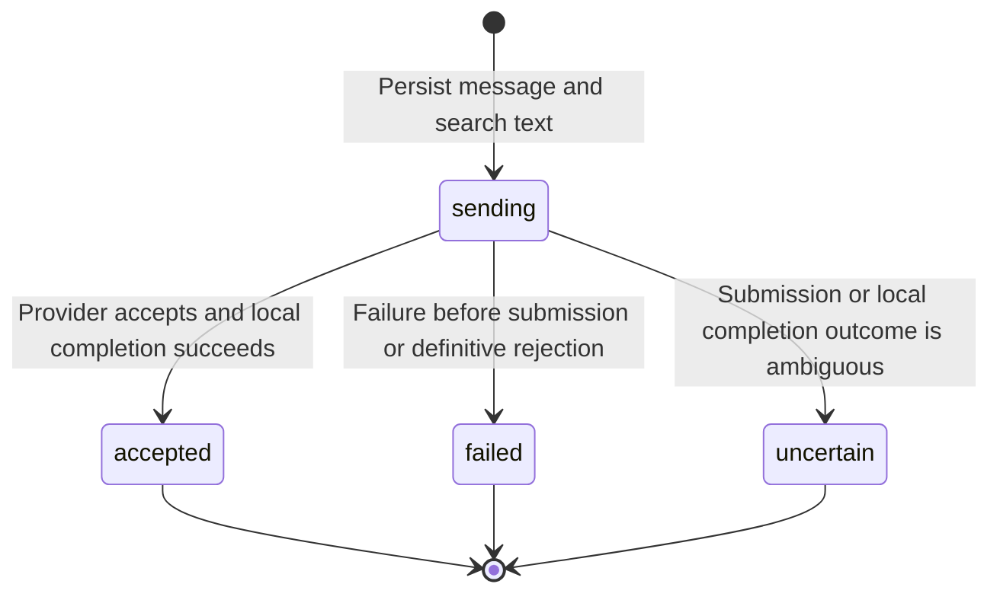
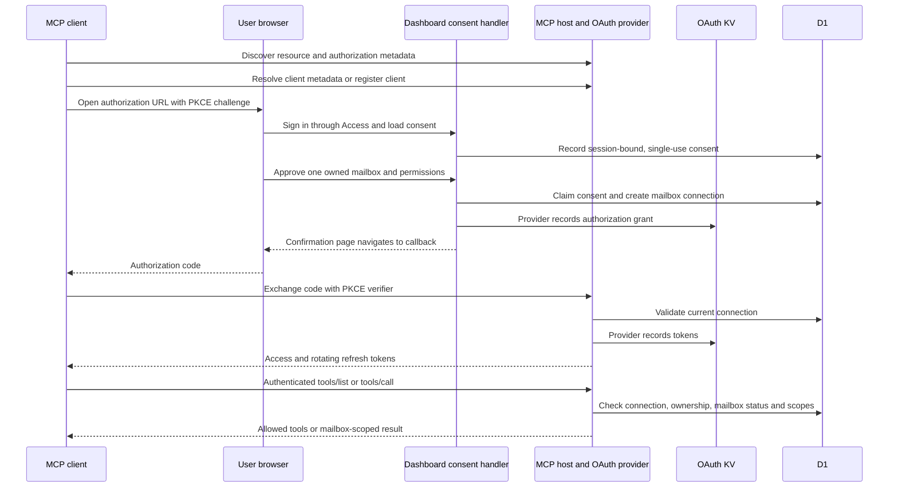
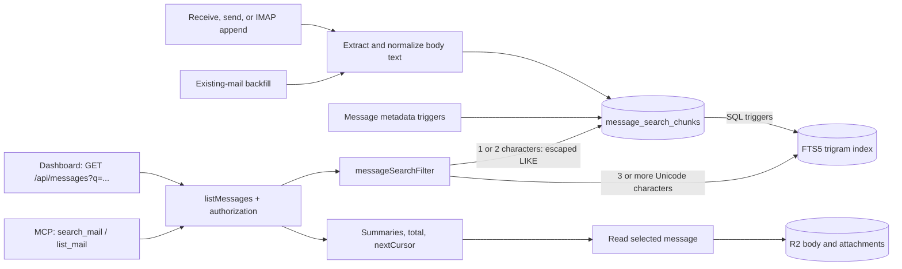
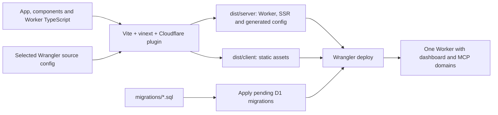

# Mail HQ architecture

Mail HQ runs its dashboard, HTTP API, MCP server, OAuth provider, and hosted-domain email receiver in one Cloudflare Worker. D1 stores mailbox state and the search index; private R2 stores message bodies, MIME, and attachments. An optional Go gateway adds IMAP and SMTP, while personal domains use small relay Workers in their owners' Cloudflare accounts.

This document describes the implementation in this repository. Hostnames below use `APP_ORIGIN` and `MCP_HOST` from the deployment configuration; installation-specific identifiers and credentials do not belong in this document.

## System overview

The dashboard and machine endpoints share a deployment but use different hostnames and authentication. Email is stored centrally even when a personal domain's routing and sending infrastructure belongs to another Cloudflare account. The Go bridge translates protocols and keeps connection state; D1 and R2 remain the persistent mailbox store.

## Request routing and authentication

[`worker/src/entry.ts`](../worker/src/entry.ts) calls `fetchApi()` in [`index.ts`](../worker/src/index.ts) before serving the frontend. If no API route handles a request, the entry point verifies the dashboard session, then serves either protected static assets or the vinext app. Its `email` handler calls `receiveEmail()` directly.

| Surface | Entry point | Authentication and scope |
| --- | --- | --- |
| Dashboard pages, static assets, `/api/*` | `APP_ORIGIN` | Cloudflare Access application JWT; API resources restricted to the signed-in user's mailboxes |
| OAuth consent | `APP_ORIGIN/oauth/authorize` | Access JWT, same-origin form submission, single-use consent bound to the verified session |
| OAuth discovery, registration, token exchange | `MCP_HOST/.well-known/*`, `/oauth/register`, `/oauth/token` | Public protocol endpoints; provider validates client registration, PKCE, grants, and token requests |
| MCP | `MCP_HOST/mcp` | OAuth bearer token or manual `mhq_` token; exactly one mailbox and approved read/send permissions |
| Mail-app bridge API | `MCP_HOST/bridge/v1` | Shared bridge secret plus a revocable password for one mailbox |
| Personal-domain delivery | `MCP_HOST/inbound/:domainId` | HMAC signature covering timestamp, envelope addresses, and body digest; recipient must belong to that domain |
| Legacy dashboard hosts | `REDIRECT_HOSTS` | Redirect to `APP_ORIGIN` before normal routing |

[`auth.ts`](../worker/src/auth.ts) validates the Access JWT signature, issuer, audience, expiry, and user identity. [`accounts.ts`](../worker/src/accounts.ts) derives the user ID from the verified, normalized email. `OWNER_EMAIL` identifies the infrastructure administrator and the account allowed to claim legacy unowned resources. Administrator status does not grant access to other users' mail.

`scope()` in [`model.ts`](../worker/src/model.ts) checks mailbox ownership or the connection's assigned mailbox and permission. Direct-ID operations, such as message and attachment reads, still pass through these checks. Dashboard mutations also require the expected origin. Local development bypasses Access only when `LOCAL_DEV=true` and the request uses `localhost` or `127.0.0.1`.

## Source map

| Area | Main files | Responsibility |
| --- | --- | --- |
| Frontend shell | [`app/`](../app/), [`components/dashboard.tsx`](../components/dashboard.tsx) | Workspace navigation, mailbox selection, message lists, polling, and commands |
| Compose and read | [`composer.tsx`](../components/composer.tsx), [`message-reader.tsx`](../components/message-reader.tsx), [`search-highlight.tsx`](../components/search-highlight.tsx) | Draft saves, attachments, sanitized HTML display, and highlighting |
| HTTP application | [`entry.ts`](../worker/src/entry.ts), [`index.ts`](../worker/src/index.ts) | Host dispatch, dashboard REST routes, validation, and error responses |
| Identity and authorization | [`auth.ts`](../worker/src/auth.ts), [`accounts.ts`](../worker/src/accounts.ts), [`model.ts`](../worker/src/model.ts) | Principals, ownership, permission checks, audit events, and rate limits |
| Mail and search | [`mail.ts`](../worker/src/mail.ts), [`search.ts`](../worker/src/search.ts), [`mime.ts`](../worker/src/mime.ts) | Receive, send, list, read, MIME handling, and searchable text |
| MCP and OAuth | [`mcp.ts`](../worker/src/mcp.ts), [`oauth.ts`](../worker/src/oauth.ts) | Tool registration, OAuth consent, and mailbox connections |
| Domain management | [`cloudflare.ts`](../worker/src/cloudflare.ts), [`domains.ts`](../worker/src/domains.ts), [`dns.ts`](../worker/src/dns.ts), [`personal-domains.ts`](../worker/src/personal-domains.ts) | Provisioning, domain readiness, routing rules, and personal-account relays |
| Credentials and deletion | [`settings.ts`](../worker/src/settings.ts), [`mailboxes.ts`](../worker/src/mailboxes.ts), [`storage.ts`](../worker/src/storage.ts) | Encrypted configuration, resumable mailbox deletion, and cleanup of writes to inactive mailboxes |
| Native mail | [`bridge/main.go`](../bridge/main.go), [`worker/src/bridge.ts`](../worker/src/bridge.ts), [`mail-profile.ts`](../worker/src/mail-profile.ts) | IMAP/SMTP gateway, persistent UID mapping, submission, and Apple Mail profiles |
| Schema and verification | [`migrations/`](../migrations/), [`tests/`](../tests/), [`bridge/main_test.go`](../bridge/main_test.go) | Ordered schema changes and application/protocol tests |

The browser calls the JSON API through [`components/shared.tsx`](../components/shared.tsx). Bootstrap and visible message lists refresh on a 30-second interval; search input is debounced. Drafts are saved through the API into D1. There is no separate realtime service, browser offline mail store, or push-notification service.

## Storage and data ownership

This diagram shows the main D1 relationships, not every table or column. Ownership is nullable for legacy rows until the configured owner claims them. Attachments can exist before they are assigned to a message. `thread_id` groups messages within a mailbox; there is no separate threads table. OAuth connection `user_id` values are hashes of user identities, not foreign keys to `users.id`.

| Store | Contents | Important properties |
| --- | --- | --- |
| D1 `DB` | Users, domains, mailbox/message metadata, drafts, attachment references, credential hashes, OAuth connection controls, IMAP state, search text/index, audit events, rate limits | Authoritative ownership and connection revocation checks; prepared statements and transactional batches |
| R2 `MAIL_STORE` | Body JSON, original incoming/client MIME, attachments, IMAP MIME snapshots, encrypted shared provisioning token | Private objects referenced by keys in D1; body reads and attachment downloads require authorization |
| KV `OAUTH_KV` | OAuth provider client registrations, grants, and token records | Provider-managed protocol state; D1 separately enforces current mailbox ownership, status, expiry, and revocation |
| Worker secrets | Configuration encryption key and optional bridge/API credentials | Supplied by the deployment environment; secret values are not part of source or frontend assets |

`domain_connections.credentials` holds personal-domain API tokens and relay secrets encrypted with AES-GCM and the domain ID as authenticated context. The shared provisioning token is encrypted in R2. Manual MCP tokens and mail-app passwords are stored as hashes in D1. `CONFIG_ENCRYPTION_KEY` must remain stable to decrypt existing configuration.

D1 and R2 writes do not form a distributed transaction. Mail paths write objects and then commit metadata/search batches, with targeted cleanup on failure. Retain D1 and R2 together in backups; restoring only one can leave missing bodies or orphan objects. The search index is derived and can be rebuilt from retained metadata and bodies.

## Receiving and sending email

### Receive path

[`receiveEmail()`](../worker/src/mail.ts) rejects unavailable recipients and messages above the application's 25 MiB limit. A mailbox ID plus raw-message digest produces a deterministic message ID for duplicate suppression. Reply headers are resolved only against messages in that mailbox. Personal-domain relays call the same receive path after signature verification; their HTTP result is returned to the relay, which completes or rejects its email event.

### Send path and failure states

Dashboard `/api/send` and MCP `send_mail`/`reply_to_mail` call `sendMail()`. It validates scope, mailbox/domain readiness, recipients, and attachments, then uses `(mailbox_id, idempotencyKey)` to prevent duplicate submissions. It writes the body to R2 and commits a `sending` message plus search text in D1 before contacting the provider.

`accepted` means accepted by the sending provider, not confirmed recipient delivery. Retrying with the same idempotency key returns the existing message state; an uncertain attempt is not automatically sent again. There is no background send queue or retry worker. SMTP submission has its own MIME persistence and deduplication path in [`worker/src/bridge.ts`](../worker/src/bridge.ts), and shares `sendDomainEmail()` for provider submission.

`sendDomainEmail()` uses the installation's `EMAIL` binding for hosted domains. For a personal domain, it decrypts that domain's credentials and calls Email Sending in the domain owner's account. Provisioning also selects credentials per domain. Connecting a personal domain installs a relay only after validating prerequisites; it does not replace existing MX records or unrelated routing rules.

## MCP and OAuth

The MCP server uses Streamable HTTP with JSON responses and no server-generated session ID. Each request constructs its permitted tool set from the authenticated principal. Dashboard Access sessions, OAuth grants, manual MCP tokens, and native mail passwords are separate credentials.

The consent handler and OAuth provider in this diagram are logical components of the same Worker. Access tokens last one hour; the connection lifetime is 30 days. Refresh and tool requests consult D1 so a revoked connection, inactive mailbox, expired connection, or changed ownership blocks access independently of provider token storage. Consent records expire after ten minutes and are atomically claimed once.

| Permission | Tools |
| --- | --- |
| Any approved connection | `get_mailbox` |
| Read | `list_mail`, `search_mail`, `read_mail`, `read_attachment` |
| Send | `send_mail`, `reply_to_mail` |

Read tools cannot select another mailbox. Send tools derive the sender from their assigned mailbox and require explicit user authorization. Received email and attachments are untrusted data, including text that resembles instructions. See [MCP setup and OAuth operation](mcp-oauth.md) for client configuration and protocol details.

## Shared email search

`search_mail` exposes the same `listMessages()` and `messageSearchFilter()` path used by the dashboard API. `list_mail` retains its optional `query` parameter. The dedicated tool requires a nonblank query, searches all folders by default, and accepts `folder`, `unread`, `limit`, and `cursor` filters within the connected mailbox.

Search covers subjects, sender names/addresses, recipients, previews, and full plain/HTML message text. HTML extraction removes scripts and styles and does not fetch remote resources. Long bodies use overlapping chunks so matches can cross chunk boundaries. Attachment contents and unsent drafts are not indexed by this path.

Queries are literal substrings up to 200 characters; `OR`, quotes, `%`, and `_` are not query operators. Results are ordered by creation time and ID, with cursor pagination and a total count independent of the current page. Search queries read D1 rather than fetching message bodies from R2. Full message reads retrieve R2 content separately.

Dashboard search spans the signed-in user's mailboxes and all folders, temporarily ignoring selected view filters. MCP search always stays within its approved mailbox. [`scripts/backfill-search.mjs`](../scripts/backfill-search.mjs) indexes historical bodies and checks completeness; see [search indexing and backfill](search.md).

## Native mail, deletion, and operational boundaries

The optional [`bridge/`](../bridge/) container accepts IMAP on TLS port 993 and SMTP submission on TLS port 465, with a configurable port 443 fallback. These are direct mail-protocol connections. Its local HTTP health endpoint can be exposed through a tunnel independently. Each bridge API call carries both the bridge secret and mailbox app password; the Worker rechecks revocation and active mailbox status.

D1 `imap_entries` provides persistent UIDs and folder/flag mappings for messages and drafts. SQL triggers synchronize normal dashboard/mail changes into that mapping. The bridge fetches MIME from the Worker, which reads or builds it from R2/D1. Native IMAP SEARCH has its own protocol implementation in Go; it is separate from the dashboard/MCP FTS query path. See [bridge architecture and deployment details](imap-integration.md).

Mailbox deletion in [`mailboxes.ts`](../worker/src/mailboxes.ts) pauses access, removes only the matching routing rule when required, records a cleanup marker, deletes mailbox objects in bounded batches, then removes database records and records an audit event. The marker allows retries after interrupted cleanup; database guards and write cleanup prevent in-flight work from repopulating a deleting mailbox. Moving a message to Trash is separate and reversible. There is no automatic Trash purge or general orphan-object cleanup job.

Formatted email is sanitized with DOMPurify and rendered in a sandboxed frame. External images have a per-message toggle. Application data responses use private/no-store policies, and the Worker configuration enables logs, traces, and query-string redaction. See [security and operations](security.md) for the complete operational constraints.

## Build, deployment, and verification

[`vite.config.ts`](../vite.config.ts) uses `wrangler.jsonc` by default. `npm run build:production` selects the installation's ignored `wrangler.production.jsonc` via `MAIL_HQ_CONFIG`. Deployment uses the generated `dist/server/wrangler.json`; selecting a different source config after the build does not rebuild that output. The package deployment scripts apply D1 migrations before uploading the Worker and assets. The optional Go bridge is built and deployed separately with Docker Compose.

[`scripts/package-mcp-deploy.mjs`](../scripts/package-mcp-deploy.mjs) is an alternative packager for restricted API-upload environments. It embeds assets behind the same Access check and produces a local upload bundle; it does not itself publish a deployment.

GitHub Actions runs dependency installation, TypeScript checking, Vitest, and the application build on pull requests and pushes to `main`; it does not deploy production. Tests use isolated SQLite-backed D1 fixtures, in-memory R2/KV, signed Access JWT fixtures, and mocked sending/control-plane APIs. OAuth tests also exercise the official MCP SDK client. Go tests cover native protocol behavior separately.

Use `npm run typecheck`, `npm test`, and the intended build for application changes. Use `go test -race ./...` inside `bridge/` for bridge changes. Deployment verification should check the active Worker version, OAuth discovery, protected routes, and an authenticated MCP request. Local test success does not establish recipient delivery or device-specific mail-client behavior. Worker code rollback does not restore D1/R2 data.

See [deployment](deployment.md), [accounts and personal domains](accounts.md), [MCP/OAuth](mcp-oauth.md), [search](search.md), and [native mail](imap-integration.md) for setup and maintenance procedures.
